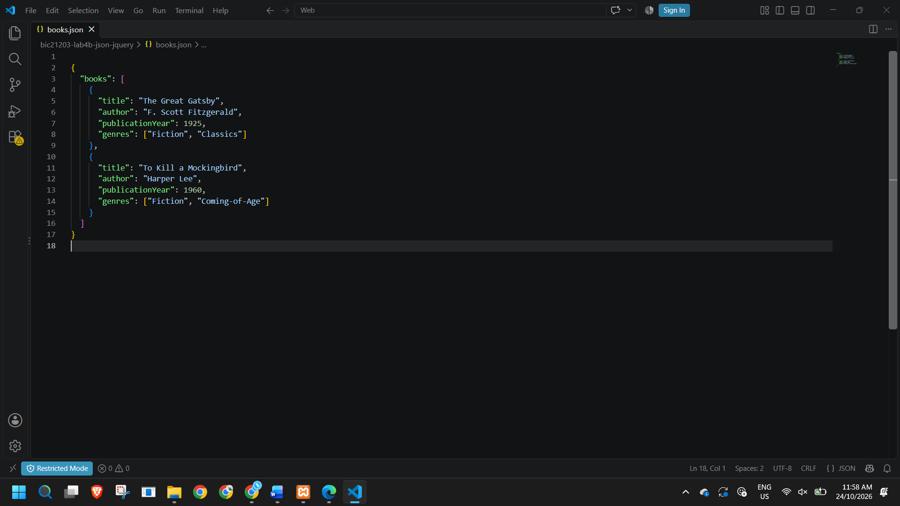
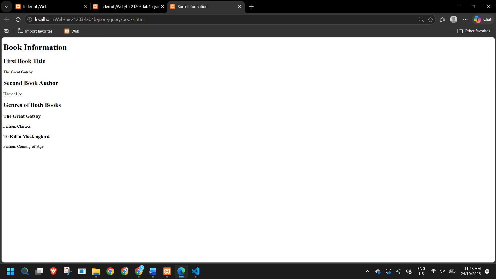
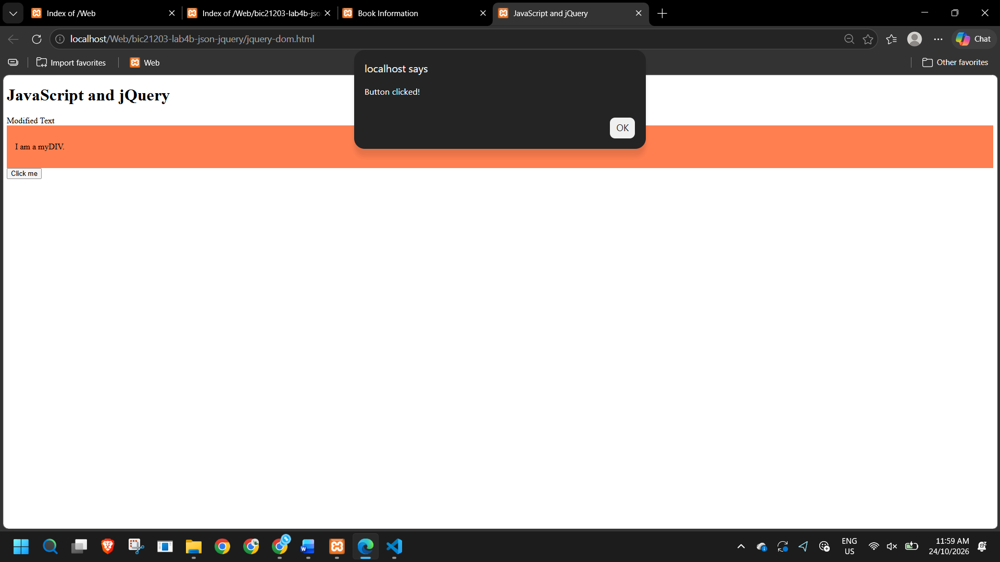

# Lab 4b: Client-Side Scripting (JavaScript)

Name:Deeviya A/P Vigneswaran  
Matric Number: CI240037  
Course Code: BIC21203

## Introduction
This lab focuses on using JSON, JavaScript fetch(), DOM manipulation and jQuery to develop interactive webpages.

## Question 1: Create and Structure JSON Data
The books.json file contains information about two books, including their titles, authors, publication years and genres. The data is organised using a JSON array containing two objects.

## Question 2: Retrieve and Display JSON Data
The books.html webpage uses the fetch() API to load book information from books.json. It displays the first book's title, the second book's author and the genres of both books. Error handling is included to display a message if the data cannot be loaded.

## Question 3: Compare Native JavaScript and jQuery
The jquery-dom.html webpage uses jQuery to change text, add a CSS class and handle a button click. The methods used are .text(), .addClass() and .on().

## How to Run
1. Download or clone this repository.
2. Open the project folder in Visual Studio Code.
3. Use Live Server to open books.html.
4. Keep books.json in the same folder as books.html.
5. Open jquery-dom.html through Live Server to test the jQuery operations.
6. Ensure you have an internet connection for the jQuery CDN.

## Screenshots
### Q1: Create and Structure JSON Data

### Q2: Retrieve and Display JSON Data

### Q3: Compare Native JavaScript and jQuery

## Reflection
Through this lab, I learned how to organise data using JSON and retrieve it with JavaScript fetch(). I also learned how to access JSON objects and display their information on a webpage. In addition, I practised using jQuery to change text, apply CSS classes and handle button clicks. This lab helped me understand the differences between native JavaScript and jQuery.
